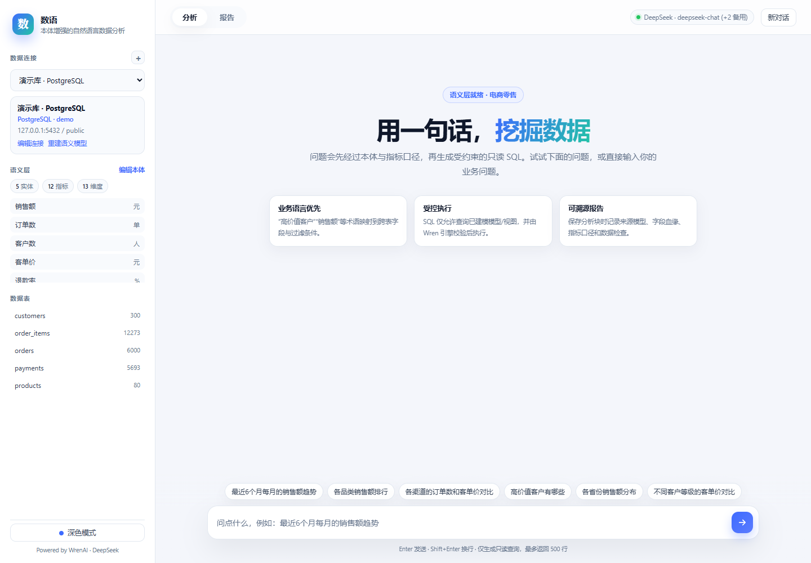
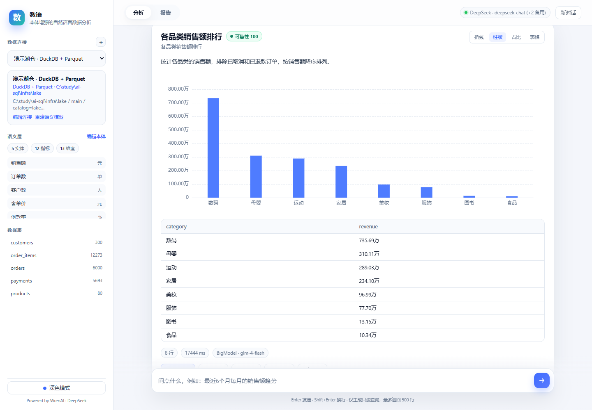
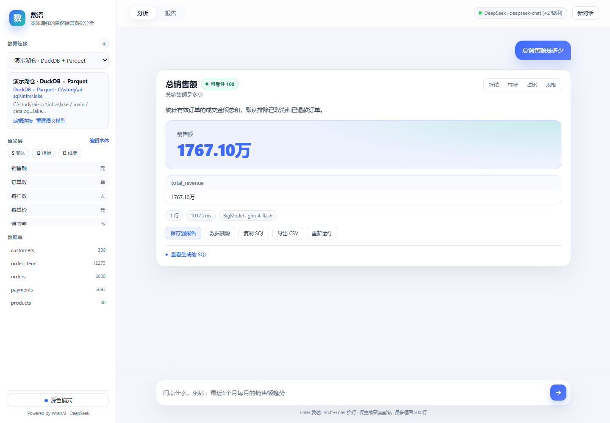
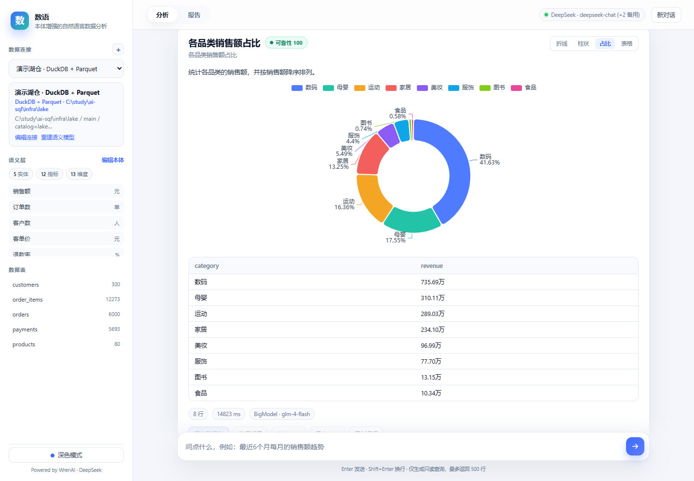
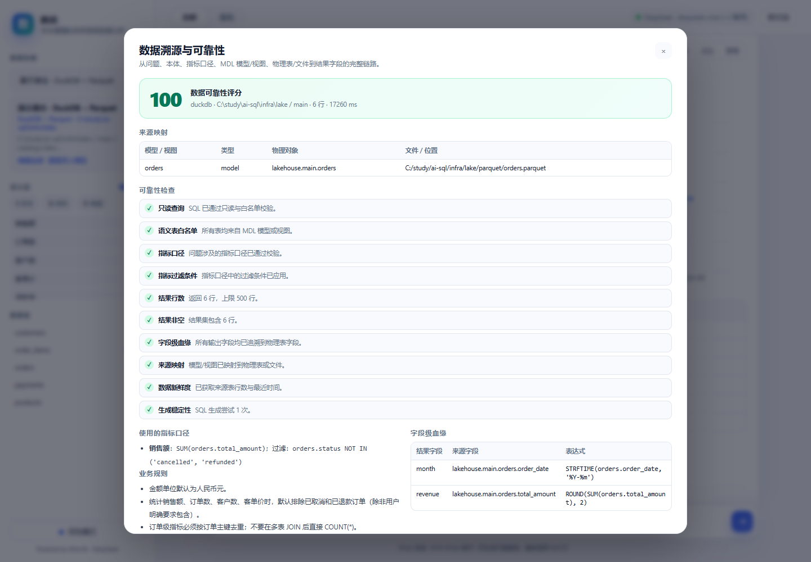
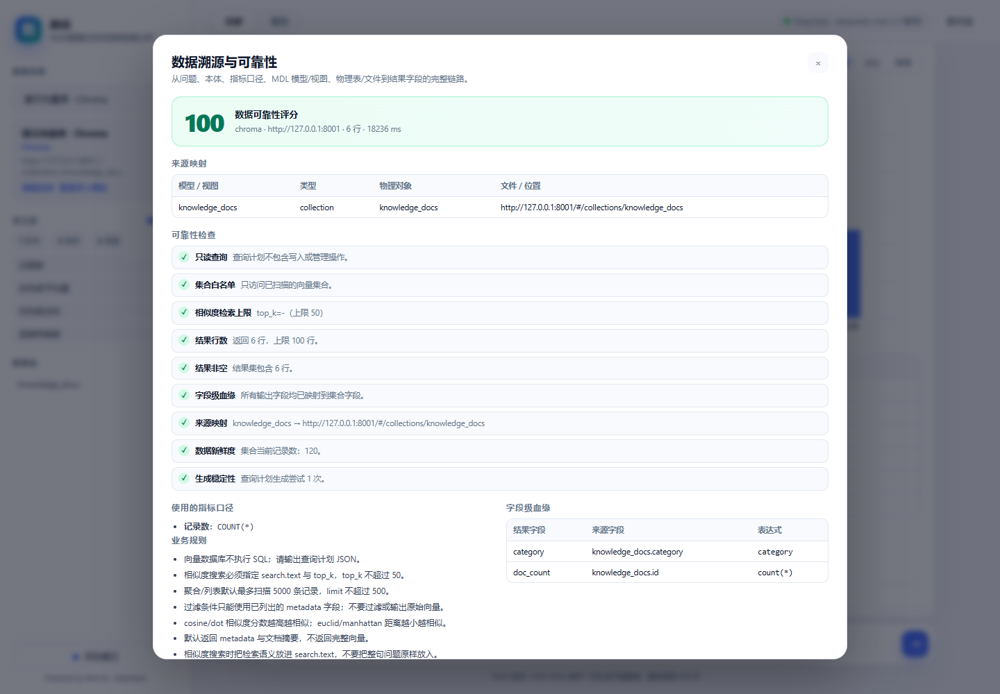
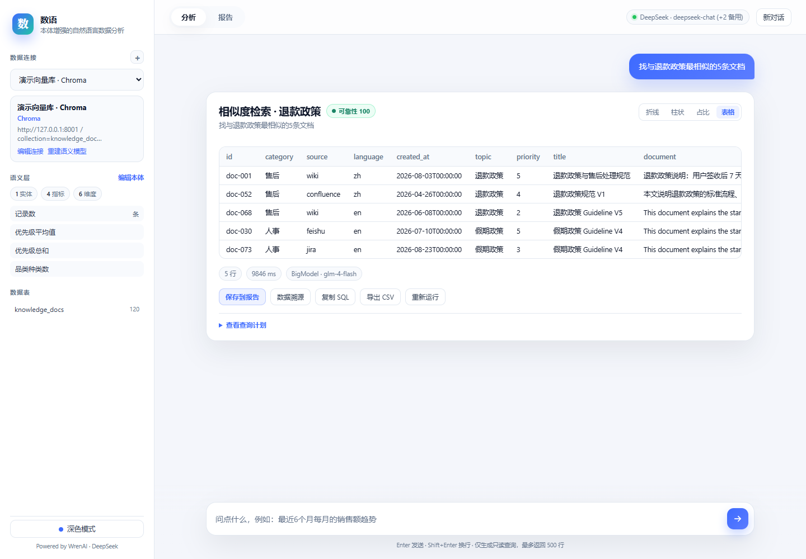
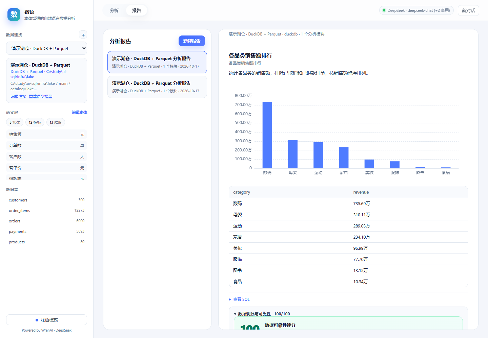
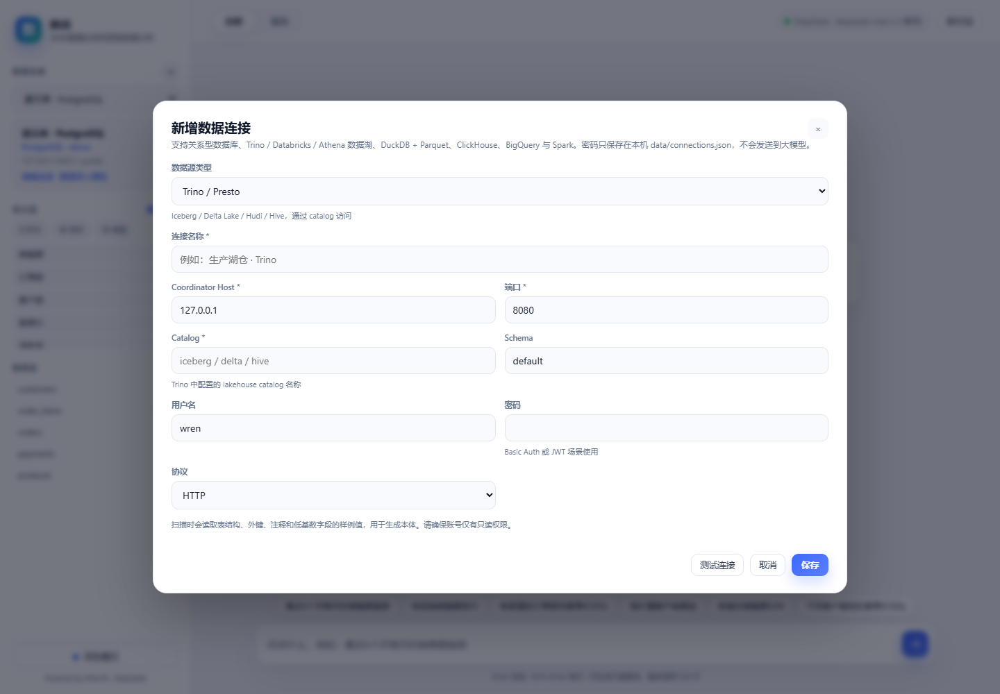

# 数语（Shuyu）

**本体增强的中文自然语言数据分析工作台** —— 基于 [WrenAI](https://github.com/Canner/WrenAI) 语义层二次开发，面向 PostgreSQL / MySQL / Oracle / SQL Server、常见数据湖 / Lakehouse 产品，以及 Chroma / Qdrant / Weaviate 向量数据库，把业务问题转换成受约束的只读查询，自动生成图表与分析报告，并为每个报表字段提供**数据溯源和可靠性检查**。

> 产品名：**数语（Shuyu）**。工程目录仍保留为 `wren-insight`，用于对照和复用 WrenAI 语义层；二者是同一个项目。
>
> 参考了「用本体（Ontology）连接业务语言与数据库」的思路：先建立实体、关系、指标口径和业务规则，再让大模型在这层语义约束内生成 SQL，而不是直接把表结构丢给模型猜。
>
> 数据湖支持：**Trino（Iceberg / Delta Lake / Hudi / Hive）、Databricks SQL（Delta Lake）、Amazon Athena（S3 + Glue）、DuckDB + Parquet、ClickHouse、BigQuery、Spark Thrift Server**。
>
> 数据溯源：来源模型 / 视图 → 物理表或 Parquet 文件 → 指标口径 → 字段级血缘 → SQL → 执行与新鲜度检查，报告导出时一并保留。

---



## 1. 调研与选型

调研时间：**2026-10-17**。GitHub 数据来自 GitHub API。

| 项目 | Stars | 最近活跃 | 语言/许可 | 语义层 / 本体 | PG / MySQL | 图表/UI | 结论 |
|---|---:|---|---|---|---|---|---|
| **Canner/WrenAI** | **17.9k** | 2026-10-16 | Python + Rust · Apache-2.0 核心 | **MDL 语义层**，模型/关系/指标/视图/知识库 | ✅ / ✅ | 内核含 GenBI 能力；**开源版不含聊天 UI** | **最终选择**：语义层最契合本体思路，工程成熟，Windows 可用 |
| vanna-ai/vanna | 23.8k | 2026-02-02（**已归档**） | Python · MIT | RAG 训练，无严格语义层 | ✅ / ✅ | 有 Plotly 图表能力，无完整工作台 | 已归档，不适合作为长期二次开发底座 |
| tencentmusic/supersonic | 5.1k | 2026-10-15 | Java · 开源 | Headless BI 语义层 + Chat BI | ✅ / ✅ | **开箱即用 Chat BI + 图表** | 功能最接近，但 Java/Spring 技术栈重，二次开发成本高 |
| eosphoros-ai/DB-GPT | 20.2k | 2026-10-11 | Python · MIT | Agent 平台，语义层不是核心 | ✅ / ✅ | 完整应用，含图表 | 体量大、依赖重，属于“平台级”方案 |
| OtterMind/Chat2DB | 28.3k | 2026-10-16 | Java · 开源 | 无 | ✅ / ✅ | 数据库客户端 + AI 生成 SQL | 偏 DB Client，不是“图表报告”工作台 |
| cube-js/cube | 21.0k | 2026-10-17 | Rust · 开源 | 纯语义层 | ✅ / ✅ | 无 NL2SQL 聊天 UI | 只解决语义层，不解决端到端体验 |
| Dataherald/dataherald | 3.6k | 2024-07（停滞） | Python · Apache-2.0 | 弱 | ✅ / ✅ | 无 | 维护停滞 |

完整对比与评分见 [docs/research.md](docs/research.md)。

### 为什么选 WrenAI？

1. **本体/语义层最匹配需求**：WrenAI 的 MDL 原生支持 models、columns、relationships、views、cubes、business rules 和 NL→SQL 示例，正好承载“业务概念 → 数据字段”的映射。
2. **工程底座可靠**：wren-core 使用 Rust + Apache DataFusion，提供 SQL 改写、方言转换、dry-plan 校验和只读策略；Python SDK/CLI 可直接嵌入。
3. **数据库与数据湖覆盖广**：原生支持 PostgreSQL、MySQL，以及 Trino、Databricks、Athena、DuckDB、ClickHouse、BigQuery、Spark 等 20+ 数据源；Windows 有 `wren-core-py` 和 `mysqlclient` 预编译 wheel。
4. **许可证友好**：核心引擎 Apache-2.0。
5. **开源边界清晰**：WrenAI 当前开源版是“引擎 + CLI + MCP + SDK”，官方聊天/GenBI UI 属于商业版。因此我们**自己实现本地分析工作台**——这正是本项目的二次开发部分。

### 二次开发做了什么？

WrenAI 提供“语义层 + SQL 执行”，但不提供面向终端用户的本地聊天和报告界面。本项目在其之上补齐：

- 数据库 schema 自动扫描与本体草稿生成（实体、同义词、关系、指标、维度、规则、示例）；
- 本体 YAML 在线编辑，保存后自动重新编译 MDL；
- NL2SQL 提示词编排、指标口径校验、SQL 只读/表白名单校验、失败自动修复；
- 常见图表推荐与渲染（折线、柱状、饼图、散点、KPI、表格）；
- 一键保存分析块、报告管理、导出带图表和 SQL 的独立 HTML；
- 中英文业务术语、演示电商数据集、自动化测试。

---

## 2. 功能

- **多数据源连接**：PostgreSQL、MySQL、Oracle、SQL Server；数据湖/Lakehouse：Trino、Databricks SQL、Amazon Athena、DuckDB + Parquet、ClickHouse、BigQuery、Spark Thrift Server；向量数据库：Chroma、Qdrant、Weaviate。
- **连接管理**：按数据源动态渲染连接字段；测试连接、编辑、切换；演示库开箱即用。
- **自动语义建模**：读取表、字段、注释、主外键、行数和低基数字段样例值；自动推断实体、关系、指标、维度、业务规则。
- **Wren MDL 生成**：为每张表/视图生成 model，生成 relationships 和两个分析视图：
  - `order_wide`：一行一订单，关联客户信息；
  - `sales_line`：一行一订单商品行，关联订单、客户、商品，适合品类/商品分析。
- **NL2SQL**：
  - 用本体、指标口径、业务规则、已确认示例构造上下文；
  - 只允许 `SELECT` / `WITH`，只允许已建模模型/视图；
  - 自动应用“排除取消/退款订单”等指标过滤；
  - 检测“客单价没有除以订单数”这类常见口径错误并自动修复；
  - 失败时把错误反馈给模型，最多重试 2 次；
  - 通过 Wren 执行，默认最多返回 500 行。
- **数据湖支持**：
  - Trino：通过 catalog 访问 Iceberg / Delta Lake / Hudi / Hive 表；
  - Databricks：Unity Catalog + Delta Lake SQL Warehouse；
  - Athena：S3 + Glue 数据湖，Parquet / ORC / JSON / Iceberg；
  - DuckDB：本地数据湖演示，DuckDB 文件中的视图直接读取 Parquet 文件；
  - ClickHouse / BigQuery / Spark：常见分析型与湖仓计算引擎。
- **企业数据库支持**：
  - Oracle 11g+ / 19c / 21c / 23ai，支持 Service Name 或完整 DSN；
  - SQL Server 2016+ / Azure SQL，通过 ODBC 连接。
- **向量数据库支持**（新增）：
  - Chroma、Qdrant、Weaviate；
  - 自动扫描 collection / class、metadata 字段、向量维度与距离度量；
  - 自然语言生成查询计划：metadata 聚合统计、明细列表、语义相似度搜索；
  - 相似度搜索 = 向量召回 + 关键词混合重排，默认返回 score/distance 与 metadata；
  - 向量化模型可配置（默认 Ollama `nomic-embed-text`，768 维）。
- **数据溯源与可靠性**（新增）：
  - 每个回答记录来源模型/视图、物理表/文件、指标口径、业务规则；
  - 基于 `sqlglot` lineage 计算**字段级血缘**（结果字段 → 物理表字段）；
  - 生成可靠性检查清单：只读、表白名单、指标过滤、行数、非空、血缘完整度、来源映射、新鲜度、生成稳定性；
  - 输出 0–100 可靠性评分；
  - 支持按需刷新来源表行数与最新时间；
  - 报告和导出的 HTML 中保留完整溯源信息与 Wren 改写后的物理 SQL。
- **图表报告**：
  - 折线（时间趋势）、柱状（分类对比）、饼图（占比）、散点（相关性）、KPI、表格；
  - 自动识别字段类型和问题意图；
  - 支持手动切换图表类型；
  - 分析结果可保存到报告，导出独立 HTML（内嵌 ECharts、SQL、溯源信息）。
- **体验**：中文界面、深色/浅色主题、推荐问题、SQL 查看/复制、CSV 导出、错误提示。
- **质量保障**：80 个单元测试；数据库、API、浏览器端到端测试脚本；内置 20 题性能基准与 trace 分阶段计时。















---

## 3. 架构

```text
┌─────────────────────────────────────────────────────────────┐
│ Browser: HTML/CSS/JS + ECharts                              │
│  - 分析对话 / 图表切换 / 报告 / 本体编辑                     │
└──────────────────────────┬──────────────────────────────────┘
                           │ REST
┌──────────────────────────▼──────────────────────────────────┐
│ FastAPI (wren-insight/app)                                  │
│                                                             │
│  连接管理 ──► Schema 扫描 ──► 本体生成 ──► MDL 生成          │
│                                     │                       │
│  用户问题 ──► 提示词编排 ──► LLM ──► SQL 护栏 ──► Wren 执行  │
│                                     │           │           │
│                                     └─ 失败修复 ◄┘           │
│                                                             │
│  结果集 ──► 图表推荐 ──► ECharts option ──► 报告/HTML 导出   │
│  结果集 ──► 溯源构建 ──► 来源映射 / 字段血缘 / 检查 / 新鲜度  │
│                                                             │
└──────────────────────────┬──────────────────────────────────┘
                           │
┌──────────────────────────▼──────────────────────────────────┐
│ WrenAI Python SDK (wrenai 0.16.0)                           │
│  - MDL 解析与 SQL 改写                                      │
│  - dry-plan 校验 / 只读策略 / 方言转换                      │
│  - wren-core-py (Rust + Apache DataFusion)                  │
│  - connectors: postgres / mysql / trino / databricks /      │
│    athena / duckdb / clickhouse / bigquery / spark          │
└──────────────────────────┬──────────────────────────────────┘
                           │
        ┌──────────────────┼───────────────────────┐
        ▼                  ▼                       ▼
   PostgreSQL          MySQL              Data Lake / Lakehouse
                                           ├─ Trino (Iceberg/Delta/Hive)
                                           ├─ Databricks (Delta Lake)
                                           ├─ Athena (S3 + Glue)
                                           ├─ DuckDB + Parquet
                                           └─ ClickHouse / BigQuery / Spark
```

LLM 使用 OpenAI 兼容的 `/chat/completions` 接口；支持主模型 + 自动回退（`LLM_FALLBACK_*`、BigModel 环境变量、本地 Ollama）。

---

## 4. 快速开始

### 环境要求

- Windows 10/11（本项目在 Windows 11 验证）
- Python **3.11 或 3.12**
- Docker Desktop
- 一个 OpenAI 兼容的大模型 API（DeepSeek / BigModel / OpenRouter），或本地 Ollama

### 一键安装

```powershell
cd C:\study\ai-sql

# 1) 启动演示 PostgreSQL + MySQL（DuckDB 湖仓演示不需要 Docker）
docker compose up -d

# 2) 创建 Python 环境并安装依赖
uv venv --python 3.12 .venv
uv pip install --python .venv\Scripts\python.exe -r wren-insight\requirements.txt

# 3) 配置大模型
Copy-Item wren-insight\.env.example wren-insight\.env
notepad wren-insight\.env

# 4) 启动
.\run.ps1
```

打开 **http://127.0.0.1:8000**。

如果暂时没有 Docker，也可以只使用本地 DuckDB + Parquet 湖仓演示：

```powershell
.\run.ps1 -NoDocker
```

也可以使用脚本：

```powershell
.\scripts\setup.ps1          # 创建 .venv、安装依赖、启动 DB
.\scripts\setup.ps1 -WithDev # 额外安装 pytest / playwright
.\run.ps1 -Port 8001         # 换端口
.\run.ps1 -NoDocker          # 已有数据库，不启动 Docker
```

不使用 `uv` 时：

```powershell
py -3.12 -m venv .venv
.\.venv\Scripts\Activate.ps1
pip install -r wren-insight\requirements.txt
```

### 演示数据源

| 数据源 | 连接方式 | 说明 |
|---|---|---|
| **PostgreSQL** | `127.0.0.1:5432` · `demo/demo123` · schema `public` | Docker 演示库 |
| **MySQL** | `127.0.0.1:3306` · `demo/demo123` · schema `demo` | Docker 演示库 |
| **DuckDB + Parquet** | 目录 `C:\study\ai-sql\infra\lake` · schema `main` · catalog `lakehouse` | **本地数据湖演示，不需要 Docker** |

演示数据为合成电商数据（约 300 客户、80 商品、6000 订单、12273 订单明细、5693 支付），日期覆盖 2025-04 至 2026-09。

本地湖仓结构：

```text
infra/lake/
├─ lakehouse.duckdb          # DuckDB catalog，仅包含视图
└─ parquet/
   ├─ customers.parquet
   ├─ products.parquet
   ├─ orders.parquet
   ├─ order_items.parquet
   └─ payments.parquet
```

`lakehouse.duckdb` 中的视图通过 `read_parquet(...)` 读取 Parquet 文件。Wren 通过 DuckDB connector attach 该数据库；溯源面板会显示：

```text
orders (模型) → lakehouse.main.orders (视图) → C:/study/ai-sql/infra/lake/parquet/orders.parquet
```

重新生成演示数据：

```powershell
.\.venv\Scripts\python.exe scripts\gen_seed.py
docker compose down -v
docker compose up -d
```

> `down -v` 会清空演示库数据，仅用于本地演示环境。

---

## 5. 配置大模型

`wren-insight/.env`：

```ini
LLM_BASE_URL=https://api.deepseek.com
LLM_API_KEY=sk-...
LLM_MODEL=deepseek-chat
```

常用组合：

| Provider | `LLM_BASE_URL` | `LLM_MODEL` |
|---|---|---|
| DeepSeek | `https://api.deepseek.com` | `deepseek-chat` |
| BigModel / 智谱 | `https://open.bigmodel.cn/api/paas/v4` | `glm-4-flash` |
| OpenRouter | `https://openrouter.ai/api/v1` | `deepseek/deepseek-chat` |
| Ollama | `http://127.0.0.1:11434/v1` | `qwen2.5:3b`（或更强模型） |

自动回退：

```ini
LLM_FALLBACK_BASE_URL=https://open.bigmodel.cn/api/paas/v4
LLM_FALLBACK_API_KEY=...
LLM_FALLBACK_MODEL=glm-4-flash
```

- 主模型调用失败（401/403/404/连接失败）时，会按 `LLM_FALLBACK_*` → 环境中的 BigModel 配置 → 本地 Ollama 的顺序尝试。
- 页面右上角显示主模型和备用数量；每条回答底部显示**实际使用**的 Provider / Model。
- 本地 Ollama 示例：`ollama pull qwen2.5:3b` 后，把 `LLM_BASE_URL` 设为 `http://127.0.0.1:11434/v1`，`LLM_API_KEY` 可留空。

### 5.1 向量化模型

向量数据库相似度搜索需要 embedding 服务。默认使用本地 Ollama：

```ini
EMBEDDING_BASE_URL=http://127.0.0.1:11434/v1
EMBEDDING_MODEL=nomic-embed-text
# EMBEDDING_API_KEY=
```

- `nomic-embed-text` 输出 768 维；集合向量维度必须一致。
- 也可以使用任意 OpenAI 兼容的 `/embeddings` 接口。
- `WREN_INSIGHT_VECTOR_MAX_SCAN` 控制聚合扫描上限（默认 5000）。

---

## 6. 数据湖 / 企业数据库 / 向量数据库支持

数语通过 WrenAI 的 connector 层接入常见数据湖 / Lakehouse 产品，并为企业数据库与向量数据库提供独立适配层。连接表单会根据数据源类型动态显示字段。

| 数据源 | 主要字段 | 适合场景 |
|---|---|---|
| **Oracle** | Host、Port、Service Name、User/Password、Schema/Owner、可选 DSN | Oracle 11g+ / 19c / 21c / 23ai |
| **SQL Server** | Host、Port、Database、User/Password、Schema、ODBC Driver | SQL Server 2016+ / Azure SQL |
| **Trino / Presto** | Host、Port、Catalog、Schema、User/Password、HTTP/HTTPS | Iceberg、Delta Lake、Hudi、Hive，统一 SQL 网关 |
| **Databricks SQL** | Server Hostname、HTTP Path、Catalog、Schema、Access Token | Unity Catalog + Delta Lake |
| **Amazon Athena** | S3 Staging Directory、Database、Region、AWS Key/Role | S3 + Glue 上的 Parquet / ORC / JSON / Iceberg |
| **DuckDB + Parquet** | DuckDB 目录、Schema、Attach 别名 | 本地 / 单机数据湖；DuckDB 视图读取 Parquet/CSV |
| **ClickHouse** | Host、HTTP Port、Database、User/Password、HTTPS | 实时分析、宽表、物化视图 |
| **BigQuery** | Project ID、Dataset、Service Account JSON（可选 ADC） | 云数据仓库 |
| **Spark Thrift Server** | Host、Port、Schema | Spark Connect / Spark SQL，需额外安装 `wrenai[spark]` |
| **Chroma** | URL、Tenant、Database、Collection、API Token | 轻量向量库、知识库检索 |
| **Qdrant** | URL、Collection、API Key | 高性能向量检索、metadata 过滤 |
| **Weaviate** | URL、Class、API Key | nearVector 相似度检索、GraphQL 聚合 |



### 6.1 连接与扫描

1. 点击左侧「数据连接」旁的 **+**。
2. 选择数据源类型，按表单填写连接信息并「测试连接」。
3. 保存后点击「扫描并生成语义模型」。
4. 扫描会通过对应 connector 读取：
   - 表 / 视图清单；
   - 字段名、类型、可空、注释；
   - 可用时的列级统计与低基数样例值；
   - DuckDB 视图会额外记录 `read_parquet(...)` 的文件位置，用于溯源。
5. 如果 catalog / schema 中没有表，先检查三段式名称（catalog.schema.table）或 Athena 的 Database、Databricks 的 Catalog。

### 6.2 本地数据湖演示

`infra/lake/lakehouse.duckdb` 只包含视图，真实数据在 `infra/lake/parquet/*.parquet`。应用首次启动会自动加入 `demo-duckdb` 连接；不需要 Docker 即可使用。

溯源链路示例：

```text
问题
  → 指标「销售额」
  → MDL 模型 orders
  → 物理对象 lakehouse.main.orders（DuckDB 视图）
  → 文件 C:/study/ai-sql/infra/lake/parquet/orders.parquet
  → 字段 orders.order_date / orders.total_amount
```

### 6.3 注意事项

- 云上数据湖需要网络可达、正确的 catalog / schema 和凭证；请使用只读账号。
- Trino / Databricks / Athena 的元数据扫描会查询 `information_schema`；不同版本的列名可能略有差异，代码已做降级兼容。
- 数据湖表通常没有强制主键/外键，本体层会使用 `id` 字段和 `*_id` 命名做启发式关系推断，建议在「编辑本体」中校正。
- 云湖仓的样例值探测只取少量行，避免产生大扫描费用；本地 DuckDB/ClickHouse 会额外做低基数字段 distinct 探测。
- Spark 需要单独安装：`pip install "wrenai[spark]"`，并配置 Spark Connect / Thrift Server。

### 6.4 Oracle / SQL Server

**Oracle**

- 默认端口 1521；Service Name 例如 `FREEPDB1` / `ORCLPDB1`。
- 也可以填写完整 DSN（`host:port/service_name`），填写后优先使用 DSN。
- 使用 `oracledb` thin 模式，本机通常不需要安装 Oracle Client。
- Schema/Owner 留空时使用用户名大写。

**SQL Server**

- 默认端口 1433；默认 Schema 为 `dbo`。
- 需要本机安装 ODBC 驱动。默认使用 `ODBC Driver 18 for SQL Server`；如果本机只有旧驱动，可在连接表单中改为 `SQL Server` 或 `ODBC Driver 17 for SQL Server`。
- 本地开发通常设置 `Encrypt=no`、`TrustServerCertificate=yes`；生产环境请按安全策略调整。

### 6.5 向量数据库：Chroma / Qdrant / Weaviate

向量数据库不使用 SQL/MDL，而是由大模型生成**只读查询计划**，支持三种模式：

| 模式 | 用途 | 示例 |
|---|---|---|
| `aggregate` | 按 metadata 统计、分组、占比、均值/求和 | 按 category 统计文档数量 |
| `list` | 按 metadata 过滤并列出记录 | 最近30天新增的文档 |
| `search` | 文本 → embedding → 向量相似度检索 | 找与退款政策最相似的5条文档 |

相似度搜索采用 **向量召回 + 关键词混合重排**，并返回 `score` / `distance`、metadata 与文档摘要，不返回原始向量。

#### 本地 Chroma / Qdrant 演示

```powershell
cd C:\study\ai-sql

# 启动 Chroma / Qdrant / Weaviate（可选）
docker compose -f docker-compose.vector.yml up -d chroma qdrant weaviate

# 写入 120 条中文知识库文档（需要 Ollama + nomic-embed-text）
ollama pull nomic-embed-text
.\.venv\Scripts\python.exe scripts\seed_chroma.py
.\.venv\Scripts\python.exe scripts\seed_qdrant.py
```

启动应用后选择 **演示向量库 · Chroma** 或 **演示向量库 · Qdrant**，点击「重建语义模型」，然后提问：

- 按 category 统计文档数量
- 各 source 的文档数量占比
- 找与退款政策最相似的5条文档
- 最近30天新增的文档

配置向量化模型（`wren-insight/.env`）：

```ini
EMBEDDING_BASE_URL=http://127.0.0.1:11434/v1
EMBEDDING_MODEL=nomic-embed-text
# EMBEDDING_API_KEY=
```

注意事项：

- 相似度搜索的 `top_k` 上限 50；聚合默认最多扫描 5000 条 metadata。
- 过滤条件只能使用已扫描的 metadata 字段；不会输出原始向量。
- Chroma / Qdrant 的本地演示已完整验证（各 120 条文档）；Weaviate 适配器已用小规模 class 验证。
- 向量维度必须与 embedding 模型一致；不匹配时会给出明确错误。

---

## 7. 数据溯源与可靠性

每个回答都会生成 `provenance`，可从回答卡片的「数据溯源」按钮查看，报告和导出的 HTML 中也会保留。

### 7.1 溯源内容

| 内容 | 说明 |
|---|---|
| 来源映射 | MDL 模型 / 视图 → catalog.schema.table → 文件位置（如 Parquet 路径） |
| 指标口径 | 问题匹配到的指标 name / expression / filters / unit |
| 业务规则 | 本体中的 rules 列表 |
| 字段级血缘 | 结果字段 → 物理表字段，附带该结果字段的 SQL 表达式 |
| Wren 物理 SQL | 语义 SQL 经 Wren 改写后的实际执行 SQL |
| 可靠性检查 | 只读、白名单、指标过滤、行数、非空、血缘、来源映射、新鲜度、尝试次数 |
| 可靠性评分 | 0–100，按检查项加权扣分 |
| 数据新鲜度 | 来源表行数、时间字段、最大值、探测时间与说明 |
| 执行信息 | 数据源、库/schema、耗时、行数、实际 LLM Provider/Model、本体生成时间 |

### 7.2 可靠性检查

- **只读查询**：SQL 只允许 SELECT / WITH。
- **语义表白名单**：只能引用 MDL 模型 / 视图。
- **指标口径**：问题涉及的指标 expression / filters 已应用。
- **结果行数 / 非空**：结果是否被截断、是否为空。
- **字段级血缘**：每个结果字段是否都能追溯到物理字段。
- **来源映射**：模型/视图是否都映射到物理对象。
- **数据新鲜度**：来源表是否有行数 / 最新时间。
- **生成稳定性**：是否经过多次修复。

### 7.3 新鲜度

- 默认使用**扫描时**的行数快照，避免每次提问都扫描大表。
- 点击溯源面板中的「刷新新鲜度」，会对来源表实时执行 `COUNT(*)` 和 `MAX(time_column)`；云湖仓可能产生扫描费用，请按需使用。
- 刷新后的新鲜度会更新当前回答的溯源信息；此时再保存到报告，报告会记录最新结果。

### 7.4 报告导出

报告 HTML 中每个分析块都包含：

- 图表与结果表；
- 语义 SQL；
- 「数据溯源与可靠性」折叠区：来源映射、指标/规则、字段血缘、检查清单、新鲜度、物理 SQL。


### 7.5 限制

- 字段级血缘基于 `sqlglot.lineage`，对极复杂的 UNION / 多层 CTE / 动态 SQL 可能只能给出部分结果。
- 云湖仓默认不做实时新鲜度探测；需要用户主动刷新。
- 扫描时行数可能是估算值（DuckDB 视图会做本地精确计数；云湖仓通常不做全表 COUNT）。
- 数据湖表没有外键时，关系推断是启发式的，建议人工校正本体。

---

## 8. 使用指南

### 8.1 生成语义模型

1. 左侧选择数据源（演示 PostgreSQL / MySQL / 本地 DuckDB 湖仓，或新增的连接）。
2. 点击 **重建语义模型**（或首页的「扫描并生成」）。
3. 应用会扫描 schema，生成：
   - `wren-insight/projects/<connection-id>/ontology.yml`
   - `models/`、`relationships.yml`、`views/`、`knowledge/`
   - `target/mdl.json`（Wren 编译产物）

### 8.2 提问

可以直接点击推荐问题，或输入例如：

- 最近6个月每月的销售额趋势
- 各品类销售额占比
- 各渠道的订单数和客单价对比
- 高价值客户有哪些
- 各省份销售额分布
- 销售额最高的10个商品
- 最近3个月各渠道的销售额趋势
- 各品类销售额排行（本地湖仓）

每条回答包含：图表、结果表、口径解释、假设、执行耗时、实际模型、可展开 SQL、可靠性评分。

### 8.3 编辑本体

点击左侧「编辑本体」，直接修改 YAML。通常会改：

- `metrics[].expression` / `filters` / `description`
- `dimensions[].expression`
- `rules`（业务规则）
- `examples`（已确认的 NL→SQL 示例）
- `glossary`（术语定义）

保存后会自动重建 Wren MDL，下一次提问立即生效。

### 8.4 图表与报告

- 回答右上角可在 **折线 / 柱状 / 占比 / 表格** 之间切换。
- **保存到报告**：首次保存会自动创建报告；之后继续追加分析块。
- **报告** 页支持查看、删除、导出 HTML、下载 HTML。
- **导出 CSV**：把当前结果集下载为 UTF-8 CSV。
- **复制 SQL / 查看 SQL**：便于审计和复用。

### 8.5 数据溯源

- 每个回答卡片右上角显示 **可靠性评分**；点击「数据溯源」查看完整链路。
- 溯源面板包含来源映射、指标口径、业务规则、字段级血缘、检查清单、新鲜度、语义 SQL 和 Wren 物理 SQL。
- 点击 **刷新新鲜度** 可对来源表实时探测行数与最新时间。
- 保存到报告时，溯源信息会一起保存；报告详情和导出的 HTML 都包含「数据溯源与可靠性」折叠区。

### 8.6 本地湖仓示例

1. 选择「演示湖仓 · DuckDB + Parquet」。
2. 点击「重建语义模型」。
3. 提问「各品类销售额排行」。
4. 点击回答中的「数据溯源」：
   - 来源映射会显示 `order_items` / `orders` / `products`；
   - 物理对象为 `lakehouse.main.*`；
   - 文件位置指向 `infra/lake/parquet/*.parquet`；
   - 字段级血缘显示 `revenue` → `order_items.quantity / unit_price / discount`。

---

## 9. 本体与语义层设计

### 7.1 本体结构

`ontology.yml` 的核心字段：

```yaml
version: 1
domain: 电商零售
dialect: postgres

entities:
  - name: 客户
    model: customers
    label: 客户
    synonyms: [客户, 用户, 消费者, 会员, buyer, customer]
    description: 客户主数据
    key: id
    attributes:
      - name: 客户等级
        column: level
        label: 客户等级
        synonyms: [客户等级, 会员等级, 等级]
        role: dimension

relationships:
  - name: orders_customers
    from_model: orders
    from_column: customer_id
    to_model: customers
    to_column: id
    join_type: MANY_TO_ONE

metrics:
  - name: 销售额
    label: 销售额
    synonyms: [销售额, 营收, 收入, 销售金额, GMV, revenue]
    expression: SUM(orders.total_amount)
    filters: "orders.status NOT IN ('cancelled', 'refunded')"
    unit: 元

dimensions:
  - name: 下单月份
    label: 下单月份
    synonyms: [月份, 月度, monthly]
    expression: "TO_CHAR(orders.order_date, 'YYYY-MM')"
    model: orders

rules:
  - 统计销售额、订单数、客户数、客单价时，默认排除已取消和已退款订单。
  - 商品/品类分析使用订单明细行金额，不要直接累加订单总额。

examples:
  - question: 各渠道的订单数和客单价对比
    sql: SELECT ...
```

### 7.2 自动生成的指标

演示库会自动识别 12 个指标，包括：

- 销售额、订单数、客户数、客单价
- 退款率、销量、商品销售额、销售成本、毛利率
- 客户总数、高价值客户数、支付金额

自动生成的 13 个维度包括：下单日期/月份/季度/年份、状态、渠道、省份、客户等级、城市、性别、品类、二级品类、支付方式。

### 7.3 MDL 视图

- `order_wide`：订单级分析（订单 + 客户），避免“订单数被明细行放大”。
- `sales_line`：明细级分析（订单明细 + 订单 + 客户 + 商品），提供 `line_amount`、`line_cost`，适合品类/商品排行。

提示词会告诉模型：订单级指标用 `orders`，商品/品类分析用 `sales_line`。

---

## 10. 关键护栏

| 护栏 | 实现 |
|---|---|
| 只读 | `sqlglot` 解析后只允许 `SELECT` / `WITH` / `UNION`，拒绝 DML/DDL 等 |
| 表白名单 | SQL 中的表必须是 MDL model/view 或 CTE 名 |
| 语义执行 | Wren `dry_plan` + 只读策略校验，再交给数据库 |
| 指标口径 | 问题提到「客单价/毛利率/退款率」等指标时，检查 SQL 是否包含除法/去重计数 |
| 默认过滤 | 问题提到销售额/订单数/客户数/客单价时，要求 SQL 应用“排除取消/退款”过滤 |
| 失败修复 | 执行错误或口径校验失败时，把错误回灌给 LLM，最多修复 2 次 |
| 行数限制 | 默认 500 行，最大 2000 行 |
| 方言 | PostgreSQL / MySQL / Trino / Databricks / Athena / DuckDB / ClickHouse / BigQuery / Spark 使用各自的日期函数和标识符引用 |

Wren 还支持在 `~/.wren/config.json` 中开启 `strict_mode`、禁用危险函数等，详见 [Wren 文档](https://docs.getwren.ai/oss/)。

---

## 11. 项目结构

```text
ai-sql/
├─ docker-compose.yml          # PostgreSQL 16 + MySQL 8.4 演示库
├─ docker-compose.vector.yml   # Chroma / Qdrant / Weaviate 向量库
├─ infra/
│  ├─ postgres/                # 建表 + 合成数据 SQL
│  ├─ mysql/
│  └─ lake/                    # 本地湖仓：lakehouse.duckdb + parquet/
├─ scripts/
│  ├─ gen_seed.py              # 生成 SQL、Parquet 与 DuckDB 湖仓
│  ├─ seed_chroma.py           # 写入 120 条 Chroma 知识库文档
│  ├─ seed_qdrant.py           # 写入 120 条 Qdrant 知识库文档
│  ├─ setup.ps1                # 安装依赖 / 启动数据库
│  ├─ test_build.py            # 扫描 + 本体 + MDL + 查询验证
│  ├─ test_ask.py              # NL2SQL 端到端验证
│  ├─ test_charts.py           # 图表类型验证
│  ├─ test_api.py              # REST API 验证
│  ├─ test_lake_provenance.py  # 湖仓 + 溯源 + 报告导出验证
│  ├─ test_provenance_api.py   # PG/MySQL 溯源验证
│  ├─ test_ui.py               # Playwright 浏览器验证
│  ├─ test_ui_charts.py        # KPI / 饼图 / 多系列截图
│  ├─ test_ui_lake.py          # 湖仓连接 + 溯源弹窗验证
│  ├─ test_ui_vector.py        # 向量库连接 + 查询计划 + 溯源验证
│  └─ poc_wren.py              # 最小 Wren SDK 示例
├─ WrenAI/                     # 上游仓库浅克隆（研究/参考）
├─ wren-insight/               # 数语应用代码（工程目录名保留）
│  ├─ app/
│  │  ├─ main.py / api.py      # FastAPI 入口与路由
│  │  ├─ config.py / models.py # 配置与 Pydantic 模型
│  │  ├─ sources.py            # 数据源类型与动态表单定义
│  │  ├─ store.py              # 连接/报告持久化
│  │  ├─ report.py             # 报告 HTML 导出（含溯源）
│  │  ├─ provenance.py         # 来源映射 / 字段血缘 / 检查 / 新鲜度
│  │  ├─ core/
│  │  │  ├─ trace.py           # 分阶段计时（benchmark 契约）
│  │  │  └─ dialects.py        # mssql → tsql 等方言映射
│  │  ├─ db/introspect.py      # 关系型/数据湖/Oracle/SQL Server 扫描
│  │  ├─ semantic/
│  │  │  ├─ ontology.py        # schema → 本体（含向量集合）
│  │  │  ├─ mdl.py             # 本体 → Wren 项目/MDL
│  │  │  └─ store.py           # 项目缓存与重建
│  │  ├─ vector/               # 向量数据库适配层
│  │  │  ├─ base.py            # 适配器契约
│  │  │  ├─ chroma.py / qdrant.py / weaviate.py
│  │  │  ├─ introspect.py      # collection → 本体草稿
│  │  │  ├─ prompt.py          # 查询计划提示词
│  │  │  ├─ planner.py         # 计划校验 / 聚合 / 混合重排
│  │  │  ├─ provenance.py      # 向量查询溯源
│  │  │  └─ pipeline.py        # 向量 NL→查询计划→执行
│  │  └─ nl2sql/
│  │     ├─ llm.py             # OpenAI 兼容客户端 + 回退
│  │     ├─ prompt.py          # 语义上下文与提示词（多方言）
│  │     ├─ pipeline.py        # NL→SQL→校验→执行→修复
│  │     └─ chart.py           # 图表推荐与 ECharts option
│  ├─ web/                     # 原生 HTML/CSS/JS + 按需加载 ECharts
│  ├─ bench/                   # 20 题固定基准、环境快照、门禁
│  ├─ tests/
│  │  ├─ test_core.py          # 核心 14 个测试
│  │  ├─ test_lake_provenance.py # 湖仓/溯源 24 个测试
│  │  ├─ test_trace.py         # trace 契约 12 个测试
│  │  ├─ test_bench_contract.py # 基准契约 10 个测试
│  │  └─ test_vector.py        # Oracle/MSSQL/向量库 20 个测试
│  ├─ requirements.txt
│  └─ .env.example
├─ docs/
│  ├─ research.md              # 项目调研与选型
│  └─ screenshots/
├─ .gitignore
└─ run.ps1
```

---

## 12. API

| 方法 | 路径 | 说明 |
|---|---|---|
| GET | `/api/health` | 健康检查、LLM 配置与备用模型 |
| GET | `/api/source-types` | 数据源类型与动态表单字段 |
| GET | `/api/connections` | 连接列表（密码/密钥打码） |
| POST | `/api/connections` | 新增/更新连接 |
| POST | `/api/connections/test` | 测试连接 |
| DELETE | `/api/connections/{id}` | 删除连接 |
| POST | `/api/connections/{id}/scan` | 扫描 schema、生成本体与 MDL |
| GET | `/api/connections/{id}/schema` | 查看扫描结果 |
| GET | `/api/connections/{id}/summary` | 实体/指标/维度/表统计 |
| POST | `/api/connections/{id}/freshness` | 按模型实时探测行数/最新时间 |
| GET | `/api/connections/{id}/ontology` | 读取本体 YAML |
| PUT | `/api/connections/{id}/ontology` | 保存本体并重建 MDL |
| GET | `/api/suggestions?connection_id=...` | 推荐问题 |
| POST | `/api/ask` | NL2SQL + 执行 + 图表 + 溯源 |
| POST | `/api/rechart` | 用已有结果切换图表类型 |
| GET/POST | `/api/reports` | 报告列表/新建 |
| GET/DELETE | `/api/reports/{id}` | 报告详情/删除 |
| POST | `/api/reports/{id}/blocks` | 追加分析块（含溯源） |
| POST | `/api/reports/{id}/export` | 生成含溯源的 HTML |
| GET | `/api/reports/{id}/html` | 查看 HTML |
| GET | `/api/reports/{id}/download` | 下载 HTML |

示例：

```bash
curl -X POST http://127.0.0.1:8000/api/ask \
  -H "Content-Type: application/json" \
  -d '{"connection_id":"demo-postgres","question":"最近6个月的销售额趋势"}'
```

---

## 13. 测试

```powershell
cd C:\study\ai-sql

# 单元测试（不需要数据库 / LLM）：80 个
.\.venv\Scripts\python.exe -m pytest wren-insight\tests -q

# 向量库演示数据（需要 Chroma/Qdrant + Ollama）
.\.venv\Scripts\python.exe scripts\seed_chroma.py
.\.venv\Scripts\python.exe scripts\seed_qdrant.py

# 性能基准 + 门禁（DuckDB 湖仓，无需 Docker）
cd wren-insight
..\.venv\Scripts\python.exe -m bench.runner --connection demo-duckdb --limit 5
..\.venv\Scripts\python.exe -m bench.runner --connection demo-duckdb --check
cd ..

# 数据湖 + 溯源 + 报告导出（只需要本地 DuckDB 湖仓）
.\.venv\Scripts\python.exe scripts\test_lake_provenance.py

# 浏览器端数据湖 + 溯源弹窗（需要应用已启动）
.\.venv\Scripts\python.exe scripts\test_ui_lake.py

# PostgreSQL / MySQL 扫描与 NL2SQL（需要 Docker 演示库）
.\.venv\Scripts\python.exe scripts\test_build.py
.\.venv\Scripts\python.exe scripts\test_ask.py demo-postgres
.\.venv\Scripts\python.exe scripts\test_ask.py demo-mysql "最近6个月每月的销售额趋势"
.\.venv\Scripts\python.exe scripts\test_provenance_api.py

# 多种图表
.\.venv\Scripts\python.exe scripts\test_charts.py

# REST API + 报告导出
.\.venv\Scripts\python.exe scripts\test_api.py

# 浏览器端到端（需要 playwright，使用本机 Edge）
uv pip install --python .venv\Scripts\python.exe playwright
.\.venv\Scripts\python.exe scripts\test_ui.py
.\.venv\Scripts\python.exe scripts\test_ui_charts.py
.\.venv\Scripts\python.exe scripts\test_ui_lake.py
.\.venv\Scripts\python.exe scripts\test_ui_vector.py
```

> 浏览器测试需要应用已在 `http://127.0.0.1:8000` 运行。`test_ui_charts.py` 会把 KPI、饼图和多系列折线截图写入 `docs/screenshots/`；`test_ui_lake.py` 会验证动态连接表单与溯源弹窗。
>
> 性能基准会把分阶段 trace、环境快照和门禁结果写入 `wren-insight/bench/results/`（已加入 `.gitignore`）。当前首屏资源约 **85KB**（ECharts 按需加载），门禁 `first_screen_kb_max=350KB` 通过。
>
> PostgreSQL / MySQL 测试需要 Docker Desktop 正常运行；如果 Docker 暂时不可用，可先使用 `demo-duckdb` 湖仓完成除 PG/MySQL 之外的全部验证。

---

## 14. 安全与限制

### 安全

- 服务默认绑定 `127.0.0.1`，没有登录/权限体系，**不要直接暴露到公网**。
- 连接密码、Access Token、AWS Secret Key、Service Account JSON、向量库 API Key 等敏感字段明文保存在本机 `wren-insight/data/connections.json`（已加入 `.gitignore`），API 返回时会打码。请使用**只读数据库账号**和最小权限凭证。
- 表结构、字段注释、低基数样例值会发送给你配置的大模型服务。敏感数据请使用本地 Ollama 或私有化模型。
- SQL 护栏是纵深防御，不能替代数据库权限控制。
- 报告 HTML 是静态快照，导出的文件包含结果数据和 SQL，分享前请检查。

### 限制

- 每个连接对应一个 catalog/schema 组合（PostgreSQL 默认 `public`，MySQL 为数据库名，Trino/Databricks 通过 catalog + schema 指定），暂不支持同一连接内跨 catalog 联合分析。
- 自动本体是启发式草稿，复杂业务语义需要人工编辑 `ontology.yml`。
- 指标口径校验是规则+启发式，不覆盖所有业务场景。
- 小参数本地模型（如 3B）在复杂 SQL 上可能不稳定，建议 7B+ 或调用商业模型。
- 每个连接对应一个语义项目，重建会覆盖自动生成内容（手工编辑请先备份）。
- 报告是静态 HTML，不是实时刷新的大屏。
- WrenAI 商业版的行/列级权限、托管 GenBI UI 等不在开源版范围内，本项目也未实现。
- 本项目用于学习和原型验证，尚未做多租户、并发、审计、密钥管理等生产化改造。
- 数据湖 connector 已通过 WrenAI 集成；本地 DuckDB + Parquet 已完整验证。Trino / Databricks / Athena / ClickHouse / BigQuery 需要你自己的服务与凭证，当前环境没有对应的云账号，因此只做了连接配置与代码路径验证，未对真实云服务做端到端压测。
- Oracle / SQL Server 的连接信息、方言、类型映射、元数据扫描代码已集成并单元测试；当前环境未启动对应数据库实例（镜像拉取未完成），因此未做端到端实测。使用前请准备可访问的实例和只读账号。
- 向量库：Chroma 与 Qdrant 均已用 120 条中文知识库文档完整验证；Weaviate 适配器已用小规模 class 验证。
- 向量相似度搜索需要 embedding 服务；默认使用 Ollama `nomic-embed-text`（768 维），维度必须与集合一致。
- Spark 需要额外安装 `wrenai[spark]`，并准备 Spark Connect / Thrift Server。
- 溯源默认使用扫描时行数快照；实时新鲜度需要手动刷新，云湖仓 `COUNT(*)` 可能产生费用。
- 字段级血缘是 best-effort，复杂 UNION / 多层 CTE 可能只能给出部分字段映射。

---

## 15. 上游与许可

- 上游项目：[Canner/WrenAI](https://github.com/Canner/WrenAI)，核心引擎 Apache-2.0。
- 本项目通过 PyPI 的 `wrenai==0.16.0` 使用其 Python SDK；`WrenAI/` 是浅克隆的上游仓库，用于研究和对照实现。
- 前端 ECharts 5.6.0，Apache-2.0，已本地化到 `wren-insight/web/vendor/echarts.min.js`。
- 演示数据由 `scripts/gen_seed.py` 生成，全部为合成数据，不包含真实个人信息。
- 二次开发代码用于学习与内部原型；对外分发时请同时遵守上游 Apache-2.0 许可与署名要求。

---

## 16. 故障排查

| 现象 | 处理 |
|---|---|
| `LLM 未配置` / `401` | 检查 `wren-insight/.env`；主模型不可用时会自动尝试 fallback 和 Ollama |
| `所有模型服务均不可用` | 确认网络、API Key、Base URL；或启动 Ollama 并拉取模型 |
| MySQL 连接报 SSL 错误 | 应用默认 `sslMode=DISABLED`；远程 MySQL 请在连接配置中调整 |
| Oracle 连接失败 | 检查 Service Name / DSN、用户名密码、监听端口；Oracle 默认 schema 是用户名大写 |
| SQL Server 连接失败 | 检查 ODBC 驱动名称（18 / 17 / `SQL Server`）、`Encrypt`、`TrustServerCertificate`、SQL 认证 |
| Chroma 扫描不到 collection | 检查 URL、Tenant/Database、Collection 名称；本地演示可运行 `scripts/seed_chroma.py` |
| 向量维度不匹配 | 集合维度与 `EMBEDDING_MODEL` 输出维度必须一致；默认 nomic-embed-text 为 768 维 |
| Weaviate class 不存在 | 检查 Class 名称大小写；匿名访问需要 `AUTHENTICATION_ANONYMOUS_ACCESS_ENABLED=true` |
| Qdrant 连接失败 | 检查 URL（默认 6333）、API Key、collection 名称 |
| `docker compose` 失败 / Docker API 500 | 重启 Docker Desktop，确认 `com.docker.service` 已启动；临时可用 `.\run.ps1 -NoDocker` + `demo-duckdb` |
| `mysqlclient` 安装失败 | 使用 Python 3.11/3.12 x64；官方 wheel 已覆盖 Windows |
| `ModuleNotFoundError: app` | 从 `wren-insight` 目录启动，并确认使用 `.venv` 的 Python |
| 端口被占用 | `.\run.ps1 -Port 8001` |
| 改了表结构但答案不对 | 左侧点击「重建语义模型」 |
| 客单价/退款率口径不对 | 在「编辑本体」中调整 `metrics` 的 `expression`/`filters`，保存重建 |
| `wren-core-py` 安装失败 | 确认 Python >=3.11、Windows x64；或使用 WSL/Linux |
| Trino 扫描不到表 | 检查 Catalog 是否存在、Schema 是否正确；Trino 使用 `catalog.schema.table` 三段式名称 |
| Databricks 连接失败 | 检查 Server Hostname、HTTP Path、Access Token、Catalog 权限 |
| Athena 连接失败 | 必须提供 S3 Staging Directory 和 Database；确认 Region / IAM 权限 |
| DuckDB 扫描不到表 | 确认目录下有 `.duckdb` 文件，且 `options.catalog` 与 attach 别名一致 |
| BigQuery 鉴权失败 | 配置 Service Account JSON（Base64）或 `gcloud auth application-default login` |
| Spark 连接失败 | `pip install "wrenai[spark]"`，并确认 Spark Connect / Thrift Server 地址 |
| 刷新新鲜度很慢 | 云湖仓 `COUNT(*)` / `MAX()` 可能扫描大量文件；按需使用，或只刷新关键表 |

---

## 17. 快速验证清单

- [x] PostgreSQL / MySQL 演示库启动并导入数据（需 Docker Desktop）
- [x] Oracle / SQL Server 连接类型、方言、类型映射与元数据扫描代码
- [x] Chroma / Qdrant 向量库扫描、metadata 聚合、相似度检索、混合重排
- [x] Weaviate 适配器（HTTP，小规模验证）
- [x] schema 扫描、本体生成、MDL 编译
- [x] Wren 引擎在 PostgreSQL / MySQL / DuckDB 上执行 SQL
- [x] 本地 DuckDB + Parquet 数据湖扫描与查询
- [x] NL2SQL 生成、只读校验、指标口径校验、失败修复
- [x] 折线 / 柱状 / 饼图 / 散点 / KPI / 表格
- [x] 多系列趋势图（月份 × 渠道）
- [x] 数据溯源：来源映射、字段级血缘、可靠性检查、新鲜度
- [x] 向量库溯源：collection、metadata、score/distance、查询计划
- [x] 报告保存、含溯源 HTML 导出、下载
- [x] 动态数据源连接表单（Oracle / SQL Server / Trino / Databricks / Athena / DuckDB / ClickHouse / BigQuery / Spark / Chroma / Qdrant / Weaviate）
- [x] 深色/浅色主题
- [x] 80 个单元测试通过
- [x] 性能基准门禁通过（首屏 84.9KB / 目标 ≤350KB）
- [x] 浏览器端到端测试无 JS 错误
